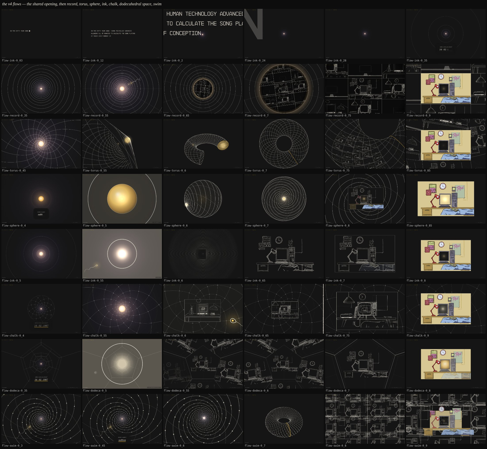

# Exploration 06: the v4 flows

The fourth round on the blackboard, and the first that is runs rather than
beats: seven whole flows of the site, each a different answer to the same
brief, on one page — **`/flows`** — to mix and match from. They were built in
parallel by seven builders and are not judged here; the lead asked for the
set and a URL.

## The brief

The lead, after the cut: _"let's make a v4 flow. terminal start. though
slightly smaller text … no 'conception --calculate' text. thats dumb. it wants
to feel clean and technical and primordial … remove most if not all the weird
math text around the page … consider other intro question scenes. especially
if they match the overall geometry of the experience, to not have too many
beats … the one [sperm] you have in most of these edits is a bit shit and
floppy … a nice spiral one that rotates properly on its axis … the
record/grooves aspect is largely missing from all your drafts … think carefully
about how we go from the arithmetic geometry to the final room … set of
agents. but dont judge them. just give me a url to see them all."_

And Garrett's notes, which set the tone: the sequence from data entry to the
room is far too long — _"pick one, two, max 3 beats for that transition"_;
_"we're giving away the joke by having the sperm spiral up during the data
entry section"_; flying closer to a mysterious glowing orb with each step of
the data entry is right, and the sperm is wasted if it is up the whole time;
simplicity — _"just a golden sphere in the center. Have the sphere do 1 design
transition to get us to the lines being drawn on it and then carry out the
rest of the sequence as is"_; and keep the parallax on the room at the end.

So every flow opens the same way — the terminal without its command line, at
a slightly smaller size: a block caret alone on the dark, the three lines of
the card typed, the full stop typed last and closing to the dot that lights
into the orb (`log-dawn.js makeTerminal(0.8, { cmd: false })`) — then takes
the questions in its own geometry, so that what follows is already there,
latent; hides the swimmer until the flash, if it shows it at all; and goes
from the last answer to the room in one, two or three beats. All in the
black-and-white sketch, ink on the dark board, gold only for the light, and
no maths written on the page. The one exception to the rule on the swimmer is
`flow-swim`, which keeps the lead's first description — the swimmer in view
from the start — so it can be compared with the six that hide it.

## What the kit gained

- **`lab/log/helix.js`** — the swimmer as a 3D helix that turns on its own
  axis: a teardrop head on the swim direction, a tail that is a helix about
  that axis, its envelope nothing at the head and widening to the tip, spun
  about the axis as it swims, so the tail corkscrews the way a flagellum does
  and nothing wobbles sideways. `drawHelix(ctx, cam, pose, …)` through any
  camera3, `poseOn(path, u, spin, size)` for a pose along a path.
- **`log-dawn.js makeTerminal(scale, { cmd })`** — the terminal at any type
  size and without its command line; it ends on the orb's first frame.
- **`log-orb.js drawPrompt, BIRTH, SPICE`** — the two questions, typed on the
  clock, anchored to a view at rest and flown past on the step. Their wiped
  patch of board is feathered by hand now rather than through a blur filter,
  which a software raster paid for every frame: with a question up the flows
  held 30 fps headless, and now hold 60.

## The seven

### `flow-record` — the record (42 s)

The light at the centre is a record's spindle hole, seen straight down its
axis. The first answer writes the grooves out of the hole in chalk, one every
quarter octave so they tighten toward it, and its step streams them out past
the edges; the second writes the rays and a dust on, and the record starts
turning. Three beats, on one pace curve that only gathers: the needle — the
swimmer, revealed only now, dropping onto a groove, the flash at the touch;
the groove in — a zoom with one full turn, the grooves wheeling out past the
edges; and the hole, opening as it passes onto the torus of rooms in chalk,
several at once, the answer's room the centre cell in its six layers, the
rim sweeping out, the colour flooding into that one room, the landing, the
sway, the chalk neighbours left round it. Best at 0.35, 0.55, 0.65, 0.7,
0.85.

### `flow-torus` — the net, lifted (40 s)

The answers draw the net. Each one draws a family of lines round the orb in
thin chalk — the birthday's twenty-one shallow spirals, indexed `1987`, then
the spice's eight steep ones crossing them at right angles, indexed
`saffron`, small and once — and each step in is two periods of the net's own
zoom, so the net lands on itself; its cells are golden rectangles: the flat
torus, before it is rolled. The flash; then two beats. The lift: the board
folds into a funnel and a tube, the orb opening into the tube's gold mouth,
and the tube bends and glues into the torus in ink, turning under the lens
from above like a record, the swimmer swimming once round a groove into the
seam as it closes. The cell: the lens drops into one cell, the cells round it
fill with chalk rooms, several at once, and it lands in the room in colour,
the glass lit, swaying, the chalk rooms still round it. Best at 0.45, 0.6,
0.7, 0.75, 0.85.

### `flow-sphere` — Garrett's sphere (40 s)

His note, made: the orb grows into a golden sphere in the centre, lit and
breathing, and nothing else is on the board; each answer flies the lens a
step closer. The flash drains the gold into a lit point at the pole facing
the lens and leaves the sphere in ink. ONE transition: the loxodrome net
writes itself onto the sphere out of the pole, eight arms one way and eight
the other, round the back in the plates' dashed hidden lines, while the
sphere turns on its axis like a record and the lens swings out and comes
back square to the pole, where the lines are log spirals converging into the
hole. Then one move: the dive through the pole, the lines streaming outward
past the edges, the room coming up out of the lit point in chalk with its
glass on the point, the colour flooding in by depth, the glass lighting, the
lens panning off the glass onto the room with a real lateral parallax, the
room swaying. The swimmer: one glint, under half a second, swallowed by the
flash. Best at 0.45, 0.6, 0.7, 0.8.

### `flow-ink` — the simplest (36 s)

The orb and its halo alone at the centre, the log map's rings round it as a
few faint grooves, one ring in per answer; the flash, with a single pass of
the helix through the wash; then ONE beat: a record's grooves spread out of
the point, each as strong as the room's ink is on that circle, and a front
moving outward resolves them into the room's lines; the colour floods in
layer by layer, the plate settles, the glass lights, the room sways on its
depths. The record is the same figure before and after the flash: log-spaced
rings the lens steps through, then a record's even grooves the room comes out
of. Worst frame about 20 ms (the prompt's blurred patch). Best at 0.35, 0.6,
0.65, 0.75.

### `flow-chalk` — the chalk fall (37 s)

The questions are asked inside the structure that will anchor the fall:
log-tunnel's golden-angle lattice in chalk, the spirals, the seeds at their
crossings and the rings, seen head on round the orb, each answer one exact
self-similar step into it so it lands on itself, closer. The dive into the
light and the flash; then the fall through six chalk rooms, glass in glass,
gathering pace, the same lattice driven by the same zoom streaming round the
plates and through every glass; the helix swimmer comes out of the flash and
leads the lens through the first glass or two, then pulls away well before
the room; the lens lands in the answer's room, the colour flooding in bed
first and wall last, the glass lit, the room swaying, the lattice faint
round it. Best at 0.4, 0.55, 0.6, 0.75, 0.9.

### `flow-dodeca` — the dodecahedral space (38 s)

The lens is inside the space from the start, looking down a straight chain
of dodecahedral cells glued face to face, each the last turned a tenth, so
the windows alternate tip up, tip down: nested pentagons in faint chalk
converging on the orb, the light at the centre of a window three cells
ahead. Each answer flies the lens on through the cells, the windows sweeping
out past the corners, the prompt riding out with them. The flash as the lens
passes through the orb's window; then two beats: the cell goes bold round us
with the answer's bedroom in chalk through every face (the largest golden
rectangle in each pentagon, eleven small draws of one chalk composite), and
the flight into the centre pane, which is the room itself, growing to the
landing size while the walls pass; the colour floods in, the chalk edges
dissolve, the glass lights, the room sways. The swimmer once, at the flash,
swimming off down the line of sight through a pane. No grooves. The chain
is Euclidean, the local picture, not the S³ chart. Best at 0.35, 0.5, 0.6,
0.7.

### `flow-swim` — the swim, for comparison (43 s)

The lead's first description, kept so it can be set against the six that hide
the swimmer — it gives the joke away on purpose. As the lens zooms into the
point the helix swimmer rises into view ahead of it, swimming at the light,
the lens behind and a little above so the tail's corkscrew reads; the net
writes itself round the light in thin chalk (log-mobius's, no colour); each
answer sends the swimmer ahead and the lens a step after it. Three beats: the
swimmer winds into the light on the net's golden spiral and the flash takes
it; the net folds into a funnel, a tube, and glues into the torus with its
gold seam, the lens diving at a window on it; the window becomes the frame,
a lattice of one chalk room, and the lens slides into one cell, the colour
flooding it, the hold. Best at 0.3, 0.45, 0.7, 0.75, 0.9.

## One-offs and variants

The lead, while the flows were being made: _"try a few different o-minimality
and abelian variety / kummer surface angles as one offs in experiments. and
more different ink sketches of the rooms and how they might appear somehow
from the geometry"_, and, of the cut, _"maybe some variants of the dodecagon
version, and the torus map stuff. and only more on those not trivial maps."_
Sketches on the board, in the index and the cut, not in the flows.

### `log-appear` — the rooms, from the geometry (11 s each)

Each opens on its geometry in chalk and ends on the landed room in colour,
no text, no swimmer; many rooms are draws of one chalk composite.

- **`cell`** — the period lattice ℤ + τℤ in chalk, the room sheared into its
  fundamental cell and every translate the same room; τ eases to i/φ, where
  the cell is a golden rectangle, the plate's own shape, as the lens zooms in.
  Best at 0.3, 0.6, 1.
- **`fold`** — the torus of rooms on the plate's own periods, folded by
  x ↦ −x: the half-turn about 0, its 2-torsion lit, a copy of the tiling
  turning through π onto itself so each room lands on its partner; one room
  kept. Best at 0.3, 0.5, 1.
- **`nodes`** — the real Kummer quartic (μ = 1.3), its sixteen nodes found
  numerically and the (16₆) configuration checked, drawn in z-sections with
  hidden lines; a tiny chalk room at each node, the lens into the highest.
  Best at 0.3, 0.7, 1.
- **`etching`** — the log map's net under w ↦ (e^{sw} − 1)/s as s runs from 1
  to 0: the rings straighten into floor and ceiling, the rays into the walls,
  the room's chalk drawn in the same coordinates. Best at 0.15, 0.4, 0.7.
- **`trope`** — the trope p = 0 touches the surface along a conic through six
  nodes; the conic, in gold, contracts onto the monitor's glass while the room
  comes up round it. Best at 0.3, 0.7, 0.85.

### `log-stage` — the stage: the 2D room stood up as flats (12–18 s)

The lead's reel: a flat drawing of a room modelled as planes in 3D, in flat
colours with thin construction lines on a blue ground, and the lens looping
round it in extreme perspective. Here it is the site's own room — the six
layers stood up in 3D exactly where the site keeps them, the wall three
units back, between a plank floor and a ceiling slab — drawn on the lab's
three.js renderer, since the flats want real perspective. From the one eye
point, far off on the axis with a long lens, it is the drawing; from
anywhere else it is a stage set, and the lines of sight from the eye
through every flat's corners, and the edges run out long, show the
projective construction. Every variant is a loop that leaves the eye point
and comes home to it: the first and last frames are the same drawing, to
the pixel.

- **`orbit`** — a dolly zoom from the drawing into the room (the long lens
  becomes a wide one close in, the frame held), a loop round the set looking
  up into it over the floor's edge and down into it over the ceiling's, and
  the dolly zoom back out. Best at 0.25, 0.4, 0.55, 0.7.
- **`swing`** — the reel's own shots: low and to one side looking up, the
  ceiling a huge triangle; high and to the other looking down; the lens
  rolled, wide. Best at 0.25, 0.4, 0.55.
- **`walk`** — in through the frame past the bed, turning to look across at
  the desk, the screen, the clock and the ceiling overhead, and back out.
  Best at 0.4, 0.5, 0.6.
- **`explode`** — the flats slide along their lines of sight from the eye,
  each on its own breath, while the lens circles near the eye: the room pulls
  apart and together and the drawing from the eye never changes. Best at
  0.3, 0.45, 0.6.
- **`shuffle`** — three different sets, each a random deal of depths, each
  the same drawing from the eye: the lens loops round one, comes home, where
  they are indistinguishable, and the next is there. Best at 0.17, 0.5,
  0.83.

The projective fact under the last two: sliding a flat along its lines of
sight from the eye, further back and larger or nearer and smaller, leaves
the drawing from the eye unchanged — so long as the flats keep their order
in depth, since where two overlap the nearer covers the farther. The deals
and the breaths keep the site's order, and the home frames agree to under
a fifth of a level per pixel, the rest being the alpha edges of flats drawn
at different sizes.

### `log-solid` — the solid: the 2D room rebuilt as a 3D room (12–18 s)

The lead, on the stage: _"that is still 2.5d. i mean full 3d rebuild of all
objects into an actual room. like what i shared. go wild."_ So here the
drawing's room is REBUILT: every object in it modelled solid, in the look of
the reel — flat colours with soft gradients on the faces, a white edge line
on every part, construction lines run out long through the whole room, drawn
over everything, the lot standing on the blue between a plank floor and a
thick ceiling slab, orange underneath, with the back wall the posters hang
on and no other walls. The desk is a long top on two drawer pedestals, their
scooped pulls recessed; the lamp an anglepoise in the drawing's red, its
bell open on a pale bulb; the computer a CRT with a square bezel, a tube
tapering behind it and a plinth under, a keyboard with its keys, a tower
with the drawing's bays and its round button, a mouse on a cable; the bed a
valance, a mattress, a blanket draped over it with its folds and a wavy hem,
a pillow at the head, the magazine lying on it; the wall's clock a red drum
with a pale face and hands at four, the Rad poster and the pink and red-sun
posters taped on, their faces cropped from the drawing's own PNGs. There are
no lights: the shading is baked into the colours. Everything stands in room
units at the place the drawing puts it, read off the composite from its eye
point, so from the eye with the long lens the model lines up with the
drawing; every variant is a loop that leaves that elevation and comes home
to it.

- **`orbit`** — out of the elevation on a dolly zoom and once round the
  room: under the floor's level looking up through the open front at the
  orange underside, round the side, over the ceiling looking down over its
  front edge into the room, and home.
- **`swing`** — the reel's low rolled corner shots: under the floor at the
  bed's corner, the blanket huge and near, the floor slab's edge diagonal
  across the frame; over the ceiling's far corner looking down, rolled the
  other way; the roll swinging with the path and 0 at home.
- **`inside`** — in through the open front over the bed's foot, up at the
  orange ceiling, round to the desk, the monitor and the lamp close, up the
  wall to the clock and the posters, the corner view, and out again.
- **`sheet`** — the drawing set, long-lensed throughout: `02 PERSPECTIVE
VIEW` at the eye, straight up to the plan with the ceiling lifted away,
  `01 PLAN VIEW` at rest, round and down to the side for `03 SECTION VIEW`,
  the slabs edge-on, and the sweep back round the front to the eye.
- **`explode`** — the exploded diagram: every part drifts out along its own
  construction — the ceiling up, the floor down, the wall back, drawers out,
  the tube back, the blanket and pillow up off the bed, posters off the
  wall — while the lines stay where the parts were, the lens arcing over,
  and everything comes home.
- **`draw`** — the drawing stands up: at the eye the flat layers are over
  the model and ARE the picture; as the lens leaves on the dolly zoom they
  dissolve into the solids, and as it comes home they come back, so the last
  frame is the drawing again.
- **`turn`** — the model shot: the room turns once on the blue under a low
  wide lens.

The kit is `lab/solid/parts.js` — `kit(THREE)` gives painted boxes,
cylinders, cones, rods and wedges (the gradient and a tint by one light
baked into vertex colours), the edge lines, the construction rays, the
textures and their crops, and `part(obj, name, explode)`, every part
carrying its name, its home and where it goes when the room explodes — and
`LAYOUT`, where everything stands. The models are `lab/solid/{room, desk,
lamp, computer, bed, wall}.js`, the loops `lab/solid/loop-*.js`, picked up
by the sketch by a glob: a new loop file is a new variant. `?part=desk`
shows one object alone on a turntable.

### `log-tame` — tame geometry (11 s each)

O-minimality: geometry with no pathology, finitely many pieces at every
scale, and the few rational points a transcendental curve can hold. Ink, gold
only for the lit points.

- **`cells`** — the set between y = 0.62 and two Gaussian humps, cut into its
  cylindrical decomposition, 37 cells counted off one by one; the helix
  swimmer crosses on a polynomial path, every crossing of a cell found exactly
  and lit — finitely many. Best at 0.5, 0.7, 0.85.
- **`height`** — y = 2^x and every rational point of height ≤ H in view, H
  rising to 12: the cloud densifies, and only the five integer points ever lie
  on the curve, all lit by H = 4. One line of text, the height. Best at 0.3,
  0.85.
- **`exp`** — the strip 0 ≤ Im z < 2π carried by (e^{tz} − 1)/t as t goes to
  1: the grid becomes rings and rays, the lattice lands on a discrete log
  spiral, the parallelogram on the annulus whose circles glue into the torus.
  Best at 0.3, 0.5, 0.7.
- **`special`** — the fundamental domain of SL₂(ℤ) and its translates down to
  a ten-thousandth of its size, every side a true geodesic, the CM points
  coming up like stars brightest first, and the geodesic Re z = 0 lit with
  infinitely many of them; the lens dives down it to the cusp. Best at 0.3,
  0.7, 1.

### `log-abelian` — abelian varieties and the Kummer surface (11 s each)

Complex tori and their quotient by −1, exact where they are maths, no text.

- **`lattice`** — Λ = ℤ + τℤ ruled out of the origin, the fundamental
  parallelogram's sides marked for their gluings, its four corners lit; the
  cell rolls into a tube with a helical seam and bends into the torus,
  untwisting by Re τ so the marks meet, and the four corners become the one
  identity of ℂ/Λ. Best at 0.3, 0.7, 1.
- **`theta`** — θ(z; τ) summed directly every frame; its invariant modulus
  drawn as level lines on the torus, bold in the cell and faint in its
  translates, the one zero at (1 + τ)/2 lit and moving as τ travels and the
  cell shears. Best at 0.3, 0.5, 1.
- **`kummer`** — the real Kummer quartic (μ = 1.3) turning in contour slices
  with hidden lines; its sixteen nodes found numerically and lit one by one,
  then the sixteen tropes' contact conics drawn one by one, each through six
  nodes. Best at 0.5, 0.85, 1.
- **`sixteen`** — the half-periods (ℤ/2)⁴ as a 4 × 4 array, each trope the six
  nodes in its node's row and column, drawn in one by one; checked against the
  computed surface to be Kummer's own incidence. Best at 0.3, 0.7.

### `log-mobius` — maps on the torus (12 s each)

Five more variants of the turn, each a real map on the torus, in ink, no text.

- **`cat`** — Arnold's cat map on the torus of rooms: the room in chalk, the
  map's one fixed point lit, three iterates drawn honestly — stretched along
  (φ, 1), cut along the integer lines into four pieces, each slid home — then
  the 192 × 192 torus run to its period of 48, the room dissolving to noise,
  a half-period ghost of four interleaved rooms, and the room back. Best at
  0.12, 0.24, 0.75.
- **`twist`** — Dehn twists: the lattice never moves, its basis is sheared
  by `[[1,1],[0,1]]` then `[[1,0],[1,1]]`, the circle each twist is made along
  glowing; meridians become (1, 1) curves, longitudes (2, 1): together, the
  cat matrix. Best at 0.22, 0.34, 0.66.
- **`weierstrass`** — ℘ folds the torus two to one onto the sphere: z ↦ −z is
  the half-turn about the axis through the four lit half-periods, the near
  half swings over, and the folded half carries its net to the sphere by ℘,
  computed by its q-series. Best at 0.3, 0.45, 0.85.
- **`hopf`** — the nest of tori in S³, projected: Hopf circles on the Clifford
  torus and an outer one, round to 10⁻¹⁵, every two linking once, the net
  streaming on a torus where the map is conformal, the lens riding its own
  Hopf circle through every inner torus. Best at 0.2, 0.4, 0.85.
- **`knot`** — torus knots as straight lines: the line of slope q/p drawn on
  the glued square and on the torus above it at once, the helix swimmer as
  the pen; the trefoil, then the cinquefoil. Best at 0.2, 0.4, 0.85.

### `log-universe` — the other space forms from inside (11 s each)

Four more closed universes, seen the way `dodeca` sees its own, in ink, no
text: each cell is the group's Dirichlet domain, built by dodeca's own rule
(the face toward g glued to the face toward g⁻¹), and the room and the
swimmer are drawn in every cell carried by that cell's group element, so
through each window the room is turned by the gluing.

- **`seifert`** — Seifert–Weber space: the hyperbolic {5,3,5} dodecahedron,
  opposite faces glued by three tenths of a turn (six edge cycles of five,
  checked), seen in the Klein ball from its centre, the lens moving by
  hyperbolic translation; the copies shrink and thin into the fog. Best at
  0.15, 0.6, 0.85.
- **`octa`** — the octahedral space S³/2O: a truncated cube, octagons glued
  by an eighth of a turn and triangles by a sixth. Best at 0.15, 0.6, 0.95.
- **`quaternion`** — the quaternion space S³/Q₈: a cube, each face glued to
  its opposite by a quarter turn in the same hand; the next room on its side.
  Best at 0.4, 0.85, 0.95.
- **`lens`** — the lens space L(5, 1): two caps meeting at 72° round a rim,
  glued by a fifth of a turn; the room set up its cap so each copy is carried
  a fifth further round, spiralling about the axis. Best at 0.15, 0.75, 0.85.

## The page

`/flows` plays the seven end to end (`/v4?chain=flows`), four and a half
minutes; ← and → step between them; `/lab?sketch=flow-record&at=0.6` pins any
frame of any of them. `/log` opens on them, and the bar in the corner steps
through them first. The one-offs and the new variants are on the board with
the rest, so `/cut` plays them too: 99 beats now, eighteen minutes.

## Not looked at yet

Portrait, and the flows live on a phone. Every flow lands in the 90s room for
the one birthday the questions type (`?decade=` picks another). The flows'
frames were checked live against their pins, each builder on its own; the
reel was stepped through end to end with no errors. On the software raster
here the heaviest stretches are the record's dive through the hole and the
chalk fall's last moment before the flash, around 25–30 ms.
