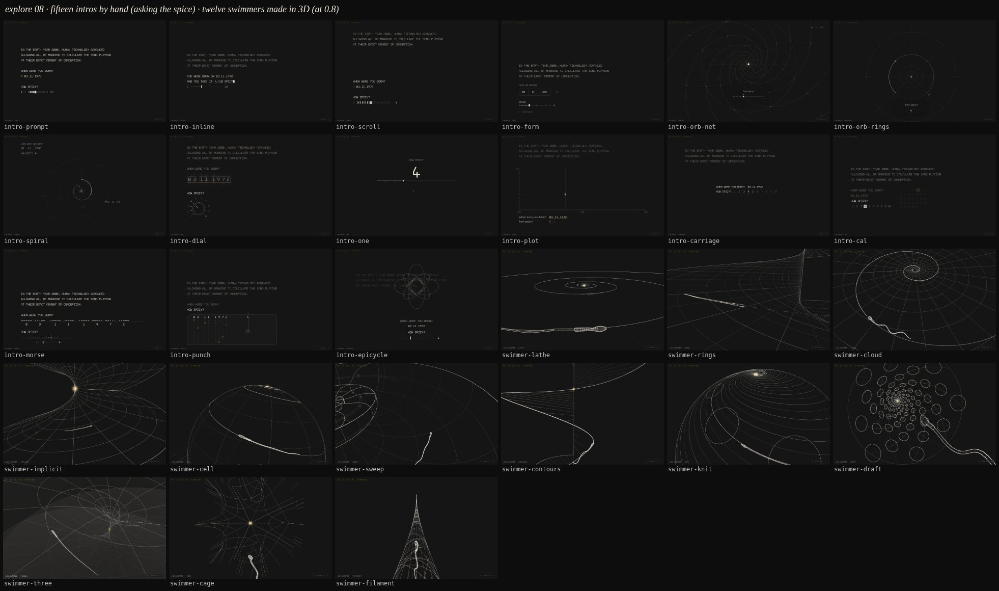

# Exploration 08: the intro by hand, and the swimmer made in 3D

Two sets, not joined, feeling out the start and the early middle. The lead
paused the full build (flow-conception, explore 07) and asked for:

- **the intro through the data entry, by hand**: the title card and then the
  two questions, the date typed and the spice (1 to 10) dragged, with the
  questions kept on the terminal rather than zoomed into a lattice, dim (the
  old log-spiral entry pages were liked but "a bit bright"), no zoom into the
  full stop, no command line;
- **a true 3D swimmer made from nothing**, the 2D helix and the lattice
  ditched, swimming toward an exact mathematical object.

Ten of each were assigned. A fan-out added more: two ideators per set, a judge
picking five. All of the new intros were built. Of the new swimmers, cage and
filament were built and heighten, axoneme and umbilic were not (see below).

## log-intro — fifteen openings

`/lab?sketch=log-intro&v=<name>`. In the lab, unpinned, **the run waits at
each question**: type the eight digits (Backspace works; Enter once all eight
are in), then drag the handle, or ← →, Home/End, a digit (0 is 10), and Enter.
Pinned (`?at=`), in a reel, or with `?demo=1` the hand is scripted (14 · 02 ·
1987, spice 7), so every frame is a pure function of progress.

All fifteen open on the terminal's title card (`makeTerminal(0.8, { cmd:
false })`) frozen at its full stop.

| variant     |                                                                                                                                                              |
| ----------- | ------------------------------------------------------------------------------------------------------------------------------------------------------------ |
| `prompt`    | the terminal carries on: the questions typed under the title, answered at a `>` prompt with a DD.MM.YYYY mask; the spice an ASCII slider `1 [■■■■□□□□□□] 10` |
| `inline`    | a second sentence with blanks the user fills in place: born on `__.__.____`, `__/10` spicy, a small slider under it                                          |
| `scroll`    | a real shell: every line arrives at the bottom and the title scrolls off the top; the spice a bar of twenty characters                                       |
| `form`      | a clean box-drawn form under the title: DD \| MM \| YYYY, a notched track, ▸ CONTINUE                                                                        |
| `orb-net`   | the stop lights into a quiet orb in place, log-orb's net round it in faint chalk; each answer one log step in                                                |
| `orb-rings` | log-orb's rings round the stop, dim; the spice a dial dragged round a ring; each answer slides the plane in one ring                                         |
| `spiral`    | time as a log spiral round the stop: a marker runs along it as the date is typed ("the spiral reading you"); the spice a bead on its inner turn              |
| `dial`      | odometer wheels roll the digits into place; a rotary knob with ten detents                                                                                   |
| `one`       | one thing at a time, large; each answer collapses to a point that flies to the full stop and joins it                                                        |
| `plot`      | the machine plots you: a timeline 1900–2099 and a 1–10 scale; the date a point sliding along one as it is typed, the spice its height                        |
| `carriage`  | one fixed hairline where the type is struck, the paper stepping under it; Enter is a carriage return; the spice a scale you drag past the point              |
| `cal`       | the month you were born in prints the way `cal` does and slides into its weekdays as the year lands; the box on your day becomes the spice's handle          |
| `morse`     | the full stop is the lamp: the date sent in dots and dashes; the spice a window sliding along the code                                                       |
| `punch`     | the date cut into a card a digit at a time, read by light; the spice one hole punched by a die                                                               |
| `epicycle`  | the date drawn as one closed curve by a chain of circles hung from the full stop; the spice sets its symmetry                                                |

The kit underneath: `log/answer.js` (new) is the one controller for both
questions: the keyboard, the pointer (a sketch hands it this frame's slider
geometry with `answers.slider(fn)`), the clock held at `wait1` and `wait2`
until Enter, the demo's hand when no one is there. Keys and the pointer are
taken only once the field is up (`wait1`, `wait2`), so typing during the
question cannot land in a field that is not drawn yet. Each variant is a
module in `src/lib/lab/intro/` with `meta = { title, order, seconds, beats }`;
the host `log-intro.js` puts `beats` and the `answers` on `window.__lab` for
test drivers.

## log-swimmer — twelve ways to make the swimmer

`/lab?sketch=log-swimmer&v=<name>`, 20–22 s each: the body generated from
nothing as a real solid (head, midpiece, beating flagellum), then set
swimming at an exact object. Hidden lines by `space.js`'s depth buffer, on the
board, except `three`, which is a shaded mesh on the lab's three.js renderer.

| variant    | the making                                                                                                                                   | swims at                                                                   |
| ---------- | -------------------------------------------------------------------------------------------------------------------------------------------- | -------------------------------------------------------------------------- |
| `lathe`    | a profile written in its half-plane, turned on its axis, pressed to the paddle, the tail drawn out                                           | the equiangular spiral, into its pole                                      |
| `rings`    | cross-sections stacked nose to tip, generatrices drawn through                                                                               | the Riemann surface of log z, down to the branch point                     |
| `cloud`    | a chalk haze condensing onto the surface, then wired                                                                                         | the spiral of e^z toward 0                                                 |
| `implicit` | a metaball sum revealed as contour slices                                                                                                    | the Riemann surface of √z, twice round the branch point                    |
| `cell`     | a round cell elongates, the head condenses, the tail buds                                                                                    | the Riemann sphere, along a loxodrome to its pole                          |
| `sweep`    | the centreline first, a tube swept round it, the head blown                                                                                  | the nautilus (a log-spiral tube)                                           |
| `contours` | the body mapped by its thickness, the map raised into slices, fall lines drawn through                                                       | ζ(½ + it), lifted over t, to its first zero                                |
| `knit`     | a quad mesh knitted round by round from the nose                                                                                             | a loxodromic Möbius flow, source to sink                                   |
| `draft`    | three orthographic views on a drawing sheet, the solid lifted between them                                                                   | a golden-angle phyllotaxis funnel                                          |
| `three`    | a shaded mesh: lathe, press, extruded tail                                                                                                   | the three sheets of z^{1/3}, into the branch point                         |
| `cage`     | box-modelled: a cube extruded into a blocky swimmer, Catmull–Clark three times, then moved to its limit surface; the cage then rigs the beat | Hanson's Fermat quintic z₁⁵ + z₂⁵ = 1, to the point where five sheets meet |
| `filament` | one thread, the pen never lifting, wound geodesic pass after pass on an invisible mandrel                                                    | up the pseudosphere's horn                                                 |

## What was checked, and what was not

- **Every intro was driven by hand** on the dev server: a wrong date
  backspaced, 03111972 and Enter, the spice set by keys, Enter. All fifteen
  took both answers. The builders also drag-tested their own sliders.
- **Every variant was shot across its run** with no page errors or warnings.
  All the board sketches hold the frame (≤17 ms) here. `three` runs at about
  300–800 ms a frame on this sandbox's software GPU, the same as `log-solid`
  on that GPU, so it is the GPU, not the sketch.
- **All 27 play in the cut** (`/cut`), right after the data entry and the
  structure.
- **Reviews.** An independent reviewer looked at eight intros (prompt,
  inline, scroll, form, spiral, one, plot, carriage) and two swimmers (lathe,
  cloud). Their must and should fixes are in. The other seven intros and ten
  swimmers were only looked at here, on contact sheets, and never had a second
  pair of eyes.
- **Rough edges, fixed after a first look** (v0.8.1).
  - `contours` lost its swimmer off a corner for about a second at 0.5, as
    the lens rose to the plan of the complex plane. The aim now leaves the
    swimmer only as fast as the lens backs off.
  - `epicycle` drew its figure over the dimmed title. The title now fades out
    while the date is asked, leaving the full stop as the figure's pivot.
  - `spiral` measured every birthday from a fixed "now" (21 · 10 · 2026). A
    person answering now gets today; pinned frames keep the fixed day, so
    they are the same picture whenever they are shot.
- **Left as it is.**
  - `three` runs at 300–800 ms a frame on this sandbox's software GPU, about
    the same as `log-solid` there.
  - Several intros show `DD.MM.YYYY` as the field's mask, because the site's
    face has capitals only.
- **Not built.** The fan-out also picked three swimmers that were never built
  because the agents hit the account's usage limit:
  - `heighten`: drawn only where a moving light strikes it, chalk
    heightening on the dark board, toward the caustic of a spherical mirror
    and into its cusp.
  - `axoneme`: the tail grows out of the centriole as nine doublets and a
    central pair, the membrane closes over it, and its beat is born as a Hopf
    bifurcation, into the Hopf diagram.
  - `umbilic`: four umbilics and the lines of curvature unspooling from them
    over an exact ellipsoid, then inward through its confocal shells along
    the focal hyperbola.

  Their specs are in the session's workflow journal, not in the repo.
