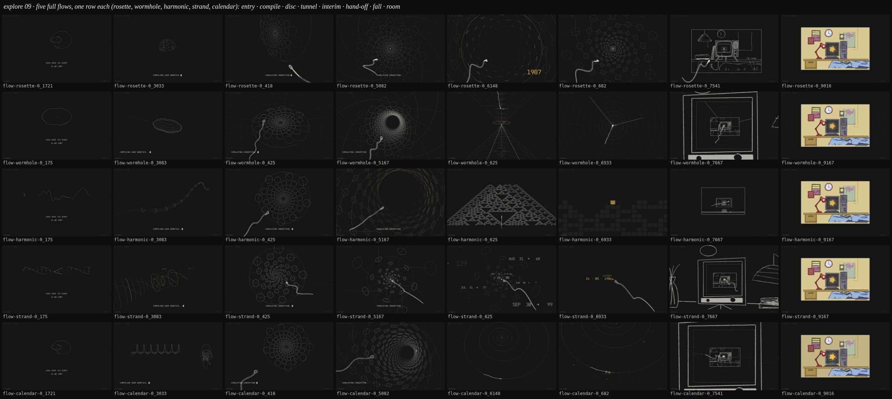

# Exploration 09: five full flows — the coefficients, the compile, the tunnel, the interim beat

The lead, after looking at the fifteen intros and twelve swimmers (explore 08):
the epicycle intro's structure was good, but the title should start centred
and be gone before the first question; the geometric swimmers (rings,
implicit) were the nicest, and the epicycles had "a nice creative feel" — so
**as you enter the data you generate the swimmer's coefficients**, then
"COMPILING USER GENETICS" builds the swimmer from them, then "SIMULATING
CONCEPTION" sets it swimming. Of the swimmers' destinations `draft` was
"absolutely best", but its disc should **open into a tunnel** — the main
tunnel the swimmer swims down — more interesting, full screen, in dramatic
perspective, over a background with "a bit more of a space time feel". And
before the rooms, at least one beat that "feels more like travelling back
through time or mathematical simulation/generations workings" — "the
biggest thing to work out". Then the chalk fall onto the final room.

Five whole runs answer that, each about 60 s, each the same pipeline:

| beat       | about       | in every flow                                                                                                                             |
| ---------- | ----------- | ----------------------------------------------------------------------------------------------------------------------------------------- |
| title      | 0 – 6.4 s   | the terminal's card typed CENTRED where it stays, frozen at its full stop, the lines fading out top first, gone before the first question |
| entry      | 6.8 – 15 s  | the date typed and the spice dragged by hand (in the lab the run waits for you); the coefficients generated visibly as you go             |
| compile    | 15 – 22.5 s | COMPILING USER GENETICS: the 3D swimmer built geometrically from those coefficients                                                       |
| conception | 22.5 – 34 s | SIMULATING CONCEPTION: draft's golden-angle disc seeded ahead of the swimmer, opening into the tunnel it swims down                       |
| interim    | 34 – 42 s   | the beat between the genetics and the rooms — each flow's own answer                                                                      |
| fall       | 42 – 54 s   | the chalk fall through the rooms, the 3D swimmer leading the lens                                                                         |
| room       | 54 – 61 s   | the splash on the year's screen, the room held                                                                                            |

Answer by hand at `/lab?sketch=flow-<name>`: type the eight digits, Enter;
drag the handle (or ← →, a digit), Enter. Pinned (`?at=`), in `/flows`, or
with `?demo=1` the hand is scripted (14 · 02 · 1987, spice 7, the 1990s room);
`?decade=` forces the room. Every frame is a pure function of progress
(each flow's pinned frames were matched against its scripted run, 0.000/255).

## The five

| flow            | the coefficients (entry)                                                                                                   | the compile                                                                                                             | the tunnel                                                                                                                                    | the interim                                                                                                                                            |
| --------------- | -------------------------------------------------------------------------------------------------------------------------- | ----------------------------------------------------------------------------------------------------------------------- | --------------------------------------------------------------------------------------------------------------------------------------------- | ------------------------------------------------------------------------------------------------------------------------------------------------------ |
| `flow-rosette`  | the epicycle intro itself: each digit an arm, the spice the figure's symmetry                                              | the figure tilts back into 3D and becomes EVERY RING of the body (its n ridges down the length)                         | the disc on its axis IS the tunnel's far view (phyllo.js's exact equivalence); dim star field                                                 | THE YEARS: the tunnel's rings count back from 2026, slow at the birth year (gold), then 266 days to conception; the far point is the first glass       |
| `flow-wormhole` | the head's OUTLINE: an ellipse is two epicycles, each digit rings in a small harmonic arm; the spice draws the tail's wave | IMPLICIT: metaballs inside the outline, the head sliced into nested contours of the person's outline                    | the disc's sheet SINKS into Flamm's paraboloid — the Schwarzschild embedding — and its throat is the tunnel; the embedding grid as background | THE LIGHT CONE: out of the throat into a spacetime diagram, the swimmer's year counting back beside it down the past light cone to the event           |
| `flow-harmonic` | the tail's BEAT: the classic epicycle-to-wave picture, each digit a harmonic, the spice the fundamental                    | SWEEP: the wave lifted as the tail's centreline, the tube swept along it tip to head; the beat is the person's waveform | a BENDING tunnel of golden-angle rings, the lens banking; star streaks                                                                        | GENERATIONS: a cellular automaton seeded with the date's bits (rule by spice) runs its history back to one cell — the first glass                      |
| `flow-strand`   | the date as BASE PAIRS on a double helix assembling as it is typed, two bases a digit; the spice its twist                 | the strand READ codon by codon, each codon expressing one ring round it                                                 | draft's own cone deepened into a log-scale horn; a receding Minkowski grid                                                                    | THE CALCULATION: the birth date minus 266 days worked across the months, Zeller's weekday, the year's room — the result's full stop is the first glass |
| `flow-calendar` | epicycles in THREE PLANES: the pen traces a space curve, the spice its symmetry                                            | LATHE: the curve's distance from its axis is the profile, turned, the head pressed                                      | the disc opens exactly onto GABRIEL'S HORN (r = 1/x)                                                                                          | THE CALENDAR SPIRAL: back along time's log spiral from now to the birthday and 266 days on to conception                                               |

## The kit under them

- `log-dawn.js` `makeTerminal(…, { align: 'center' })` — the card typed
  centred where it stays. `intro/epicycle.js` now does exactly the lead's
  notes (centred, never moved, gone before the first question; only the full
  stop, alone, glides to the figure's pivot) and exports `EPICYCLE`,
  `rosette(digits, spice)` and `make({ keep: true })` for a flow to open on.
- `log/body.js` — the swimmer every flow uses from the compile on: stations
  nose to tip, sections (an ellipse, or the date's rosette), generatrices, the
  contour, hidden lines, the travelling beat with the head yawing, the roll;
  placed free or laid along a path; `specOf(answers)` makes each person's body
  a little their own (the digits set its proportions and the beat's shape,
  the spice its beat and roll). Under ~3 px across it is drawn as a thread, so
  it still reads leading the lens into a glass. On its own:
  `/lab?sketch=log-swimmer&v=genome`.
- `log/phyllo.js` — draft's golden-angle disc (seeds; the 8 and 13
  parastichies, exact) and its opening into a tunnel: a lens on the axis at
  distance E sees a tunnel point of radius a at depth D where the disc has
  its seed at ρ when D = E·a/ρ, so the disc seen down the axis IS the tunnel;
  then the log map onto a cylinder.
- `log/caption.js` (COMPILING USER GENETICS, SIMULATING CONCEPTION, typed in
  the terminal's face), `log/splash.js` and `rooms.js decadeOfDate`, lifted
  out of flow-conception.

## What was checked

- Each flow was built by one agent and reviewed by another who drove it by
  hand (a wrong date backspaced, 03 · 11 · 1972, spice 4 — a visibly different
  swimmer, landing in the 1960s room) and fixed what they found: 5 to 8
  problems each (a compile camera that jumped, a disc drawn off-screen, a
  light that popped, coefficients too small to see, a swimmer flung across the
  screen, interim workings piled on top of each other …).
- Every flow was shot at 40+ pins and looked at, the hand-offs between beats
  at dense pins; pinned frames match the scripted runs.
- Frame cost is unproven: the sandbox's four cores were loaded 10–20 while
  five builders ran, and the probes read 17–50 ms (the fall's rooms, the
  kit's, reach 33–67 there too). On a quiet machine the board flows have held
  17–33.

## Known weak points (from the reviews)

- Seen from straight behind the swimmer reads as a squiggle; every flow keeps
  the lens a little to the side, but some moments in the tunnels still show
  it.
- `rosette`: the head seen from behind is a crumpled flower; the caption
  touches the tail around 31 s.
- `wormhole`: the higher harmonics make peanut-shaped heads; the second turn
  of the light cone (39–41 s) is busy.
- `harmonic`: the year's ripple is smoothed out of the body; the automaton
  covers the tunnel's floor more than its walls.
- `strand`: the horn reads a little like a flower; "no zoom into the full
  stop" is a judgement call (the result's stop becomes the first glass at the
  fall's own zoom).
- `calendar`: the 266 days are a slow crawl; the tail runs off a corner down
  the horn.
- In every flow the swimmer's tail is drawn over the falling plates without
  clipping to the glass.
