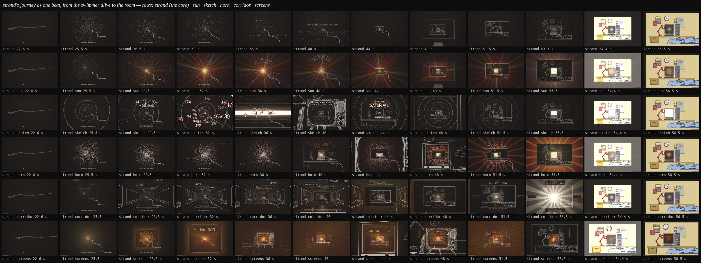

# Exploration 10: strand's journey as one beat — five answers

The lead, after the five full flows (explore 09):

> i think strand is my fav by far. the big issue with it however. is the
> tunnel scene. how you had the math and dates and stuff come up i think is
> funny. but the tunnel itself is a bit crap … a lot of the other tunnel
> scenes seemed to be quite slow … the bigger issue is that the first part
> of the tunnel and swimming through the rooms should be more well
> integrated. this is the real thing i want you to work on.
>
> … the tunnel scene should feel like one scene. one beat. rn it very much
> feels like two.

And: no grid floor; a warm, evolving fuzz rather than static ("a soft warm
VHS-esque noise. not putting random VHS features in"); end on a bright white
flash and let the room's colour come up from it; the final room much closer
to full size; the phone fixed — for strand only, "building for each build is
pointless". The radial "sunshine" lattice the lead had before — a log-polar
lattice seen at its point at infinity, in spectral reds, oranges, golds and
yellows, "part akira part lion king all math" — for the wonder of the
moment; and, from a frame of Eva / Akira, a sketchier, shakier, warmer hand.

## The core, fixed first (`flow-strand`)

- No grid floor. The board's fixed chalk dust is replaced by
  `log/grain.js`: six warm noise tiles (amber, rose, cream) drawn soft at 12
  a second, each at its own seeded offset, and three faint warm washes
  drifting on slow incommensurate periods — the tape's soft fuzz, moving,
  none of its features. Drawn last on every frame.
- The end is a white flash (`log/flash.js`), and the room comes up OUT of
  it: after the white is held a moment it burns out as an overexposed frame
  recovers — a colour-dodge by a grey falling from white, so the dark ground
  comes back at once and the room's lights last, the wall's cream through
  white, the lamp's red through pink — rather than a white veil thinning to
  grey over the dark. A flow that renders three.js under its board passes
  `under: true`, and the board's clear parts are kept clear over the GPU's
  picture.
- The last room ends near full size: `log/fall.js` `makeFall({ fill })` with
  `beats.push` dollies in on the landed room to 0.94 of the board's height
  (an upright phone crops its sides).
- On a phone: touch entry (the kit's, explore 09), the title and captions
  wrapped and readable, the compile and the swimmer framed for an upright
  screen — strand only.

## The five journeys

Each keeps strand to the end of the compile (the swimmer alive at 22.2 s)
and rebuilds everything from there to the flash at 53.7 s, as ONE
continuous movement through ONE space. Each was built by one agent and
reviewed by another, who shot dense strips across the whole span, diffed
every frame against the next looking for a dip, a cut or a pop, and fixed
what they found.

| flow                   | the one beat                                                                                                                                                                                                                                                                                                                                                                                                                                                                         | the dates and maths                                                                                                                                                                            | GPU / board                                                                              |
| ---------------------- | ------------------------------------------------------------------------------------------------------------------------------------------------------------------------------------------------------------------------------------------------------------------------------------------------------------------------------------------------------------------------------------------------------------------------------------------------------------------------------------ | ---------------------------------------------------------------------------------------------------------------------------------------------------------------------------------------------- | ---------------------------------------------------------------------------------------- |
| `flow-strand-sun`      | Draft's seeds are sown and DAWN into a spectral log-polar sun: the seeds are the lattice's integer points, so the disc's spirals are the sun's. Down its axis a zoom is a translation, so the rings stream out for as long as it runs; from 38 s the rings near the centre are the nest's own frames, the first glass is the gold date's full stop, and the rooms come up inside the rings with the sun behind every glass. Its core is the last screen; the white flash is the sun. | Written on the sun's plane: the birth arch, the months as rays on its spokes (the golden angle apart), the landing bowl, Zeller's arches, the room's rule, the date in gold at the centre.     | the sun: one TSL pass under the board; the rest the board                                |
| `flow-strand-sketch`   | The anime hand: every stroke boils on twos. Hand-drawn rings and speed lines from the vanishing point; the rings flatten into a WHITE-HOT BAND, the round tunnel become the slot between two planes; the swimmer dives through it as it parts like a tube switching on, and the slot's lines close back into rings round every room — the tunnel never stops.                                                                                                                        | The 266 days hand-lettered flying out past the lens, each struck through in red, the months crossed off; the date written on the band and ringed; Zeller over the rooms, SATURDAY ringed.      | all board: the lines are the picture (`log/sketch-hand.js`, a boiling context)           |
| `flow-strand-horn`     | The horn and the nest are the same self-similar object on one zoom: far off a room is the horn's circular section; as it nears the circle squares off into its frame and the room is drawn out of the horn's own seeds. The horn stays round every frame and through every glass; the lattice warms into sunshine and its rays swell into the flash.                                                                                                                                 | The months borrowed back one a ring, written on it as it opens; then one card pinned above each room's monitor (the landing day, Zeller over three rooms, the rule); the date in gold.         | the horn, its seeds, spirals, rings and light: one TSL pass; rooms, cards on the board   |
| `flow-strand-corridor` | Back through time down a corridor whose walls ARE the decades' rooms, labelled in their colours, the birth year's room its far end from the first frame; one zoom down it, the end growing into the last room and the swimmer on into its monitor, a sunburst in the screen swelling into the flash. No tunnel turns into rooms: it was rooms from the start.                                                                                                                        | The corridor's signage: years on hanging signs counting back, struck through; the birth sign; a sign a month; the 266 days on a floor ruler to 0 at the door; Zeller and the date on the door. | the walls' light, the wall rooms (one instanced draw, one atlas), the floor ruler: GPU   |
| `flow-strand-screens`  | The machine computing it live, on screen after glowing screen: the fall's own nest entered from far before its first room, so at first only the screens glow in the dark; the lens goes through each into its light, which thins as the next room comes up out of the dark round the next screen (monitor chalk, then desk and bed, then walls). Draft's disc is the first screen's picture.                                                                                         | Typed in the terminal's face on the screens, one block a screen: the birth date, − 266 DAYS, the months struck through in red, MAY 31 − 7 = 24, Zeller, the rule, the date in gold.            | the phosphor light and the sunshine on the glass: one pass (the board on a software GPU) |

Look at them at `/lab?sketch=flow-strand-<name>` (answer by hand, or
`?demo=1` for 14 · 02 · 1987, spice 7), or end to end in `/flows`, where they
follow strand. Every frame is a pure function of t: each reviewer matched
pinned frames against a scripted run at two moments in the journey
(0.000/255), and checked the arithmetic for every birth date from 1900 to
2099 against `Date` (none wrong; 14 · 02 · 1987 → Saturday 24 · 05 · 1986,
03 · 11 · 1972 → Friday 11 · 02 · 1972 through FEB 29, 29 · 02 · 2000 →
Tuesday 08 · 06 · 1999). By hand and by touch on a phone, upright and
sideways, all five land.

## Cost

The old tunnels were slow because the board stroked thousands of fogged line
pieces a frame on the CPU. Here the field-like work is on the GPU and the
board's own work is level with the core's (`?gpu=0`, `?sun=0`, `?field=0`
show the board alone). What could not be measured is a real GPU: this
sandbox's is software (SwiftShader), on which merely putting a WebGL canvas
on the page costs 30–150 ms a frame whatever it draws, so the GPU variants
read 50–150 ms here against the core's 33; on a GPU the passes are a few
hundred operations a pixel, a few milliseconds. On a software renderer they
draw their fields at reduced size (sun 0.4, horn a pixel budget) or, for
screens, on the board; `?sunres=1`, `?fieldres=1`, `?glow=1` force full
resolution, as the sheet above is shot.

## Known weak points (from the reviews)

- `sun`: the rings becoming the frames is subtle (it reads as the room
  growing out of the full stop); from 46 s each crossing pulses between a
  dark room and a bright glass; on a phone the late months brush Zeller's
  arch.
- `sketch`: the date holds on the band ~1.8 s; the slot and the rings round
  the rooms are drawn in screen space, not built; the blizzard is cluttered
  on a phone; a few glyphs are crude.
- `horn`: 27–38 s is the same self-similar view, plain chalk, and may feel
  long; the swell before the flash is bright.
- `corridor`: about a second of near-stillness before the light swells; the
  corridor narrows by the lens, not in fact; the sunburst is bold.
- `screens`: the months are evenly paced (nine screens, 1.5 s each); the
  middle rooms repeat; only the screen outlines are shaky.
