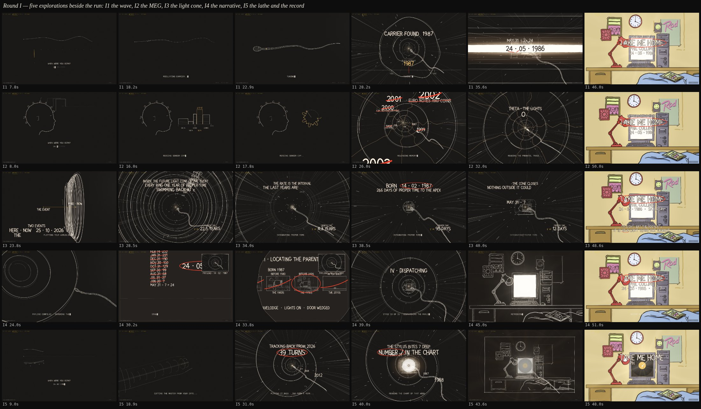

# Exploration 11: round I — five explorations beside the run

The lead, with cut H the run at `/next`:

> we have a whole load of variants … the having a tunnel, the cartoon font,
> the idea of generating sperm from the user input, all of that is perfect.
> however. there are many other ways to generate sperm. i liked some.
> especially those that used wave information. there are also many
> different ways to transitions and do all the other parts of a site.
> before we lock into this version. can you set up 5 agents to go read
> through and understand the various other directions we have explored …
> and go and make 5 different variants. with the same rough length and
> pacing of H. and i want these to really branch out and explore.
> different ways of generating the sperm. different ideas of copy and
> narrative flow. different notions of space time. or reading the users
> brain waves (simulating MEG). call these I1 - I5.
>
> think about the narrative in the users head. the flow should make some
> narrative sense. as to the computations going on in the conception
> calculator.

Five agents, one variant each, from a copy of H (its length and pacing, its
entry, its page API, its hold and AGAIN and PLAY, its three verdicts), each
with its own table of words (`log/sketch-copy-i<n>.js`) and its own helpers
(`log/i<n>-*.js`); nothing shared was touched. They play at `/next?v=i1` …
`?v=i5` (`?demo=1`, `?at=`, `?edge=` as the run) and in the lab.

## I1 — the wave (`?v=i1`, 52 s)

The birthday is a SIGNAL. The entry is an oscilloscope: a plain sine, the
carrier, and a spectrum of bars under it; each digit typed lights a bar and
lays a harmonic on the trace, the spice is the gain. MODULATING CARRIER
winds the swimmer's body round that trace — the tail is the person's own
Fourier series travelling, the head the carrier. The tunnel's rings are
wavefronts bent into the signal; a DIAL under the swim tunes back down the
years (a headline flickering at each) to rest on the birth year; CARRIER
FOUND · FINE TUNE − 266 DAYS; the count; LOCK, the wave on the band flat
and the date lettered on it; the room RECEIVING; SIGNAL RECEIVED. A verdict
is SIGNAL LOST. `log/i1-wave.js`: `harmonicsOf`, `makeBeat` (the tail's
tangent angle integrated from the series), `carrierSection`, `signalOf`.

## I2 — the MEG (`?v=i2`, 54 s)

The calculator does no arithmetic: it READS the person typing. A head in
profile in a sensor cap, eight leads to a strip of channel traces, every key
an evoked spike on the hand's own clock, the spice the gain. The strip
becomes a SPECTRUM (delta to gamma, each band powered by a part of the date,
the dominant ringed with its Hz), the bands turn as epicycles drawing the
figure that is the swimmer's section, and the body is written from it. The
tunnel is a trip INWARD along the memory: the eight traces down its walls,
the years rewound with their headlines, NO MEMORY BEFORE the birth, the
prenatal trace read on band by band (DELTA · A ROOM, THETA · THE LIGHTS …)
to GAMMA · A SONG ON, LOCKED; the flash is the memory lit; MEMORY
RECOVERED. A verdict is TRACE LOST. `log/i2-meg.js`.

## I3 — the light cone (`?v=i3`, 54 s)

Relativity straight-faced. HERE · NOW and THE CONCEPTION are two events;
the person is a worldline between them that never moved, so the interval is
proper time and the sum is "integrate τ back to the apex". The lens pulls
WIDE once to show the diagram side-on, then the tunnel is the event's
future light cone seen from inside: the rings a calendar of proper time, a
ring a year struck as the nose crosses it, the months inside the gestation,
a τ METER counting down; the swimmer a worldline tube, each ring
Lorentz-contracted by a digit. No band: the apex FLARES, the date is
lettered on the white and ringed, the flash comes off it. At the end: its
light left the room at c and is so many light years out tonight.
`log/i3-worldline.js`.

## I4 — the narrative (`?v=i4`, 54 s)

Copy-first: the calculator in its own voice, four numbered pages in the
hand, each with its own transition. The swimmer is the PAYLOAD, compiled
first and kept swimming in an inset top right while the machine works:
I · SUBTRACTING 266 DAYS, a ledger of months struck off, the date ringed —
the page torn away; II · LOCATING THE PARENTS, four polaroids of the
decades' rooms, three crossed, one ringed, the dossier — an iris;
III · SOLVING FOR THE NIGHT, Zeller written out, SATURDAY NIGHT ringed, the
chart position — wiped by an eraser onto the tunnel full frame;
IV · DISPATCHING, addressed TO: the date, the fall watched with no band,
the swimmer into the screen, the flash; V · RETRIEVING THE RECORD, the
song. The sperm is H's, recast as the thing being sent.

## I5 — the lathe and the record (`?v=i5`, 54 s)

The calculator is a cutting lathe and a gramophone. The digits are the
eight harmonics of one wave, the spice how deep the cutter bites; that
profile is the silhouette of a solid of revolution, and the swimmer is the
date turned on the lathe — the stylus. The tunnel is ONE GROOVE, a helix
down the cone, a turn a year, the years lettered on the turns, the readings
as the stylus tracks in (the year; 38 weeks further in; the chart that
week; the spice as how deep it bites). At the centre the LABEL, a white disc
with the spindle hole dark in it and the date under the hole; the stylus
dives through the hole into the room; a record turns on the monitor, the
tone arm swings in, THE NEEDLE DROP is the flash; the song on the label. A
verdict is pressed with the gif: the needle skips. `log/i5-profile.js`,
`log/i5-record.js`.

## What each agent said was weak

- I1: the wave on the band's edges is subtle; the spectrum's weights fall
  fast so the year's digits barely change the trace; the rings are H's cone
  modulated, not re-spaced as wavelengths.
- I2: the head is a diagram, not a character; the figure-to-section is a
  cut, not a lens move; the wall traces fade at the band rather than locking
  into it; BETA dominates most dates.
- I3: the wide view is brief and the cone reads as a horn side-on; the year
  labels crowd as the lens settles; the end is H's with new words.
- I4: the inset-to-full-frame hand-off at the wipe is a jump; stage III is
  thin; the polaroids are the only colour before the flash; not laid out for
  a phone.
- I5: the groove is a helix on H's cone, not a new surface; "a turn a year"
  is approximate; the record's label on the screen is small at rest.

The agents' full reports, with beat tables and next steps, are in the
session's scratch; the beats are in each sketch's header.
