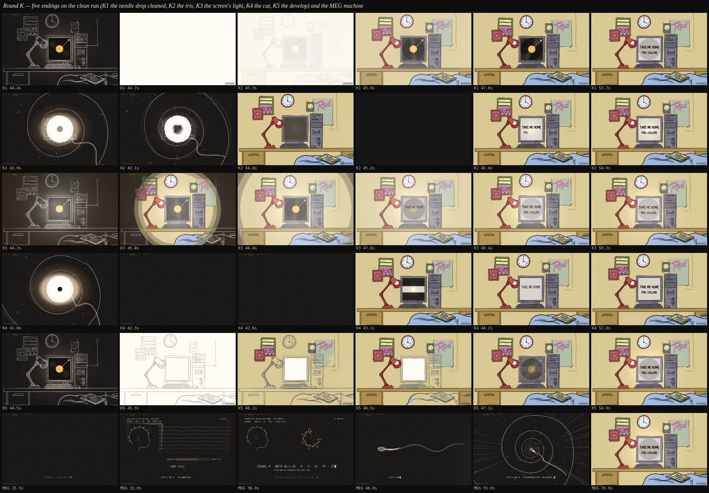

# Exploration 12: round K — five endings on the clean run, and the MEG machine

The lead, after the call with the PM:

> we think simplicity is good. no extra text on the fly in. just clean sperm
> generation from DNA, then into the spiral. clean until the scene. though
> keeping the compiling user genetics / simulating conception. no date no
> math no conversation no nothing.
>
> i3 has the nicest sperm generation. its slightly cleaner which i like. then
> i5 with the spiral the sperm flies into is perfect. lets take exactly that.
> but drop the dates. … and no extra text all the way until the conception
> room. thinking through about how we can cleanly do the final flash and room
> reveal. we have a cleaner scene. so it may be worth you trying a few
> variants (5) there for me to view and give feedback on. … so far this
> flash has been the messiest and least clean part. so it is the thing to
> explore.
>
> oh also. the final output. embed and all. should really be on the computer
> screen.

## The run: cut K

The run at `/next` is cut K: I3's sperm generation (the entry's double
helix; the body written ring by ring, each ring a circle contracted by a
digit of the date, flashed in gold — `log/i3-worldline.js`) into I5's groove
(one helix down the cone, turning under the stylus, nothing lettered on it),
the label at the apex with the spindle hole and no date, the dive through
the hole, the record on the monitor, the needle drop as the flash, the room
in colour. The only words on the fly-in are COMPILING USER GENETICS and
SIMULATING CONCEPTION. The output is on the computer screen: the song and
its artist lettered on the glass as the record dims, and the page's PLAY /
AGAIN and the Spotify embed on the glass too (`sketch.screen()` gives the
page the glass each frame). `docs/next-beats.md` times it. Cut H is kept at
`?v=h`.

## The five endings (`?v=k1` … `k5`)

Each is the run to the dive through the hole, exactly, and then one idea for
the flash and the reveal. Nothing shared was touched; each is one file (K5 a
copy of `fall.js` with one option).

- **K1 — the needle drop, cleaned.** The record and the arm stay; the needle
  drop makes a short, even white (the board to white in 0.08 s, held 0.42 s)
  with no rays, no burn and no rings of light, and the colour is simply
  there as the white lifts in one even fade over 1.1 s; the screen's halo
  goes within a second, the room is still. Nothing to tune.
- **K2 — the iris, no flash.** The spindle hole is a porthole onto the room
  ALREADY IN COLOUR (the last room floods under the label, unseen); at the
  dive the hole widens as a true iris, the colour room growing in it, the
  white label a ring round it for a third of a second, and the lens falls on
  into the room and comes to rest. No white at all. The monitor switches on
  softly, amber then cream, and the song is on it. The quietest reveal.
- **K3 — the screen's light.** The hole takes the frame onto the chalk
  room; at the needle drop the monitor brightens to a soft warm glow and the
  room's colour is carried out of the glass inside it as a radial wipe to
  past the corners in 2.6 s (`fall.js reveal`), no white over the board; the
  glow draws back into the screen and the song is on it.
- **K4 — the cut.** The hole is dark; it swallows the frame to black, a
  quarter second of black, and the room is there in colour, at rest, with
  the monitor dark — the one cut in the run, on the beat. The CRT switches
  on (a dot drawn into a line, the line opening into the picture) and the
  song is on it. No flash, no record, no arm; 52 s.
- **K5 — the develop.** The needle drop takes the board to an even white, a
  sheet of paper, and the room develops on it like a print: the chalk lines
  first as ink, then the flat colours painted in cel by cel — the wall, the
  poster, the clock, the desk, the bed, the screen last — over a second and
  a half; the record on the glass, the song. `?wipe=0` fades each cel up
  instead of painting it across.

## The MEG machine (`?v=meg`)

For the lead's own humour. After the date and the spice the Conception
Calculator 2000 is a piece of medical equipment, straight-faced: STANDBY ·
PRESS ANY KEY (live it waits for a key or a tap; the demo presses it), POWER
ON · SELF TEST with a clock and a subject line, STEP 1 READING MEG (the
sensor cap on a head in profile, eight channel traces with the 10–20 names),
STEP 2 CALIBRATING (a baseline bar, the noise floor, each channel ticked),
STEP 3 THINK ABOUT YOUR FATHER'S SPERM (the frontal channels respond, a bar
fills, SIGNAL A CAPTURED in femtotesla), STEP 4 NOW THINK ABOUT YOUR PARENTS
HAVING SEX (every channel saturates, SIGNAL B CAPTURED), the spectrum with
the dominant band ringed and traced as epicycles, STEP 5 REVERSE-ENGINEERING
SPERM FROM SIGNAL (the body written from the signal's rosette, each ring
flashed), STEP 6 RECONSTRUCTING THE EVENT — and from there the run's own
journey and end, 23 s late; 77 s. Every word in `log/sketch-copy-meg.js`.

## What each agent said was weak

- K1: a hard pop on a software GPU (the rise is under a frame); the screen's
  halo before the hit is a little heavy.
- K2: the white ring lasts only ~0.35 s before the hole passes the label;
  the colour cels jitter through the iris until the landing; with no flash
  there is no "moment" but the monitor's switch-on.
- K3: the wipe's feathered edge shows as two faint rims at 45.2 – 45.8 (the
  three-step feather in `fall.js`); the glow is a vignette while the room is
  coloured.
- K4: ~0.4 s of near-black before the true black; a few last streaks of the
  rush over the dark; the screen's picture is a flat pale tone.
- K5: the wipe reads as a cut on the small cels; the ink stage is short
  (0.55 s); the record pops onto the glass with the screen's cel.
- MEG: long and talky by design; the saturated traces read as square waves;
  the phone layout only sized.

The agents' full reports, with beat tables and next steps, are in the
session's scratch; the beats are in each sketch's header.
